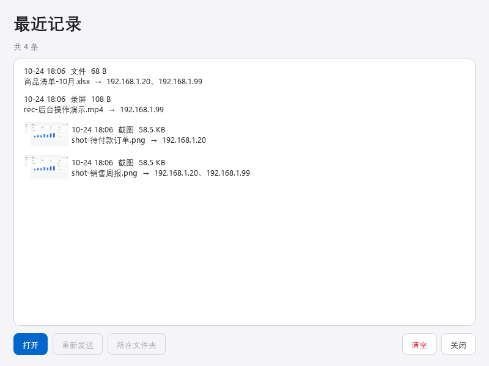
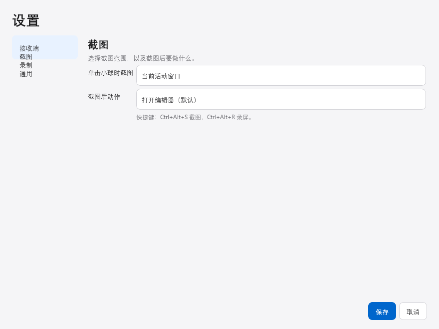

<p align="center">
  <a href="README.md">简体中文</a> | <a href="README_EN.md">English</a>
</p>

<div align="center">
  
  <h1>速截</h1>
  <p><strong>点一下悬浮球，截图、标注、录屏，直接出现在你的其他电脑上。</strong></p>
  <p>局域网直连 · 原图无压缩 · 无需登录 · 不经过任何云服务</p>
  <p>
    
    
    
    
  </p>
</div>

---

## 为什么需要速截

如果你有两台以上的电脑——台式机 + 笔记本、公司电脑 + 家里电脑——你一定遇到过这些时刻：

- 笔记本上要用的东西在台式机屏幕上，**微信传一下？** 要登录、要掏手机、图片还被压缩得模糊；
- 想把一段操作演示发给另一台电脑，**录屏存 U 盘？** 拷来拷去，文件早不知道去哪了；
- 网盘同步？先上传再下载，几十 MB 的录屏等得起吗。

**速截把这些动作压缩成一秒钟**：在这台电脑上点一下悬浮球，截图（或录屏、或任意文件）直接出现在其他电脑的「图片\速截」文件夹里——原图质量、局域网速度、一个账号都不用注册。

| | 微信 / QQ 传文件 | 网盘中转 | **速截** |
| --- | :-: | :-: | :-: |
| 原图质量 | 会被压缩 | 看会员脸色 | **PNG 原图直传** |
| 需要登录 / 手机扫码 | 是 | 是 | **不需要** |
| 速度 | 看外网带宽 | 先传后下载 | **局域网直连** |
| 一次发多台电脑 | 逐个发 | 各自下载 | **同时送达** |
| 对方电脑关机了 | 发不出去 | 等它上线 | **自动补发** |
| 数据经过哪里 | 腾讯服务器 | 网盘服务器 | **只在你自己的局域网里** |

## 界面一览

<table>
  <tr>
    <td align="center" width="50%">
      <br>
      <sub>一颗悬浮球常驻桌面，单击即截图</sub>
    </td>
    <td align="center" width="50%">
      <br>
      <sub>长按展开四向菜单：截图 / 录屏 / 贴图 / 记录</sub>
    </td>
  </tr>
  <tr>
    <td align="center" width="50%">
      <br>
      <sub>画笔、箭头、矩形、文字、马赛克，标完直接发</sub>
    </td>
    <td align="center" width="50%">
      <br>
      <sub>贴图：把参考内容钉在屏幕最上层，随写随看</sub>
    </td>
  </tr>
  <tr>
    <td align="center" width="50%">
      <br>
      <sub>扫描局域网，一次配置多台接收电脑</sub>
    </td>
    <td align="center" width="50%">
      <br>
      <sub>发过什么一目了然，随时重发</sub>
    </td>
  </tr>
</table>

## 核心特性

### 1. 一颗球搞定所有操作

不需要记快捷键、不需要找窗口。悬浮球停在桌面角落，**单击**就按当前方式截图（活动窗口 / 当前显示器 / 整个屏幕 / 手动框选）；**长按**展开四向扇形菜单，滑向哪个方向就执行哪个动作，松手即触发。嫌它碍事？拖到任何边缘，或直接隐藏用全局热键。

<div align="center">
  
</div>

### 2. 截图 → 标注 → 发送，一气呵成

截图自动打开编辑器：画笔、箭头、矩形、圆形、文字、马赛克，支持撤销重做。标注完点「发送」，同时送达**所有**接收电脑。不想发送？`Ctrl+C` 复制到剪贴板、`Ctrl+S` 保存到本机、或者直接贴在屏幕上。

<div align="center">
  
</div>

### 3. 截图后做什么，你说了算

设置 → 截图 → 「截图后动作」四种模式一键切换：

| 模式 | 适合谁 |
| --- | --- |
| 打开编辑器（默认） | 需要标注、打码后再发 |
| **直接发送** | 追求极致速度：单击 → 秒到对方电脑 |
| **复制到剪贴板** | 粘贴到别处用，本机动作、零依赖 |
| **贴在屏幕上** | 照着参考图干活的人 |

配上全局热键 `Ctrl+Alt+S`（截图）和 `Ctrl+Alt+R`（录屏），手不离键盘。

<div align="center">
  
</div>

### 4. 不止截图：录屏、贴图、发任意文件

- **录屏**：内置 ffmpeg，显示器 / 全屏 / 窗口 / 框选区域，录完自动发送，可加麦克风解说；
- **贴图**：把截图钉在屏幕最上层，滚轮缩放、拖动移位，对照抄写、比对两处界面的利器；
- **发送任意文件**：右键悬浮球 →「发送文件…」，文档、压缩包、安装包都能发，**接收端保留原文件名**——「报价单.docx」过去还是「报价单.docx」，不会变成一串时间戳。

### 5. 多台电脑同时收，掉线也不丢

一次配置，N 台电脑同时接收；某台暂时关机？未送达的文件进待发队列，它一上线自动补发——已经收到过的电脑**不会重复收**。每个接收端还可以单独设置共享密钥。

### 6. 最近记录

发过的每张截图、每段录屏、每个文件都在「最近记录」里：带缩略图、可打开原图、打开所在文件夹、一键重新发送。清空记录也绝不误删你电脑上的原始文件。

## 30 秒上手

1. 在两台 Windows 电脑上安装同一个安装包，连入同一局域网；
2. **选工作模式**：首次启动会弹出模式选择，之后随时可改——开始菜单里有「只截图」「只收图」「同时截图和收图」「更改本机工作模式」四个快捷方式，收图模式的托盘菜单里也有「本机工作模式」；
3. 截图电脑打开「设置 → 接收端」→ 点「扫描局域网设备」→ 双击添加 → 保存；
4. 单击悬浮球。完事。

三种模式怎么选：

| 模式 | 这台电脑做什么 | 桌面上有什么 |
| --- | --- | --- |
| 只截图 | 发截图、录屏、文件给别人 | 悬浮球 + 托盘图标 |
| 只收图 | 安静地收文件，不做任何截图操作 | 只有托盘图标 |
| 同时截图和收图 | 既能发也能收 | 悬浮球 + 托盘图标 |

收到的文件默认存在「图片\速截」，按日期自动分文件夹，托盘点一下就能打开。

## 真实使用场景

- **双机办公**：笔记本开会记笔记，台式机跑重型任务；台式机上的结果截图，一秒到笔记本，直接贴进会议记录。
- **开发者联调 / 报 Bug**：复现步骤录成屏，直接出现在同事电脑上，不用先传网盘再发链接；报错弹窗标注个红框箭头，一键发出去。
- **给长辈远程支持**：在长辈电脑上装好接收端，你这边点一下，操作演示就出现在他们屏幕上——按 `Ctrl+Alt+R` 开始/停止录屏。
- **照着参考干活**：把需求图钉在屏幕右上角，缩放到合适大小，一边看一边写，不用来回切窗口。
- **跨机搬运小文件**：一个配置文件、一份文档，右键 → 发送文件，比共享文件夹和网盘都快。

## 常用操作速查

| 操作 | 效果 |
| --- | --- |
| 单击悬浮球 | 按当前方式截图，执行「截图后动作」 |
| `Ctrl` + `Alt` + `S` | 全局热键：截图（任何界面下有效） |
| `Ctrl` + `Alt` + `R` | 开始 / 停止录屏 |
| 长按后向上滑 | 截图 |
| 长按后向左滑 | 开始录屏；再次单击悬浮球停止并发送 |
| 长按后向右滑 | 把当前画面钉在屏幕上（贴图） |
| 长按后向下滑 | 打开最近记录 |
| 右键 → 发送文件… | 挑选任意文件发到所有接收端，保留原文件名 |
| 编辑器里 `Ctrl+C` / `Ctrl+S` | 标注结果复制到剪贴板 / 保存到本机 |

## 网络与隐私

速截**只在你的局域网内直连传输**：数据不经过云服务、不经公网中继、不需要注册账号。安装包自动为专用网络配置防火墙规则（TCP 8765 传文件，UDP 8766 设备发现）。

传输使用 HTTP，内容未加密；共享密钥用于接收端的访问校验。请只在可信局域网中使用，不要把接收端端口映射到公网。

## 常见问题

**安装后找不到悬浮球？**
说明这台电脑当前是「只收图」模式——收图模式只驻留托盘，本来就不显示悬浮球。打开开始菜单的「更改本机工作模式」（或收图托盘图标右键 →「本机工作模式」），切换到「只截图」或「同时截图和收图」，悬浮球就会出现。

**接收端收不到文件？**
确认两台电脑在同一局域网、Windows 网络类型是「专用网络」；在截图端「设置 → 接收端」点「扫描」或用「测试连接」，失败会显示具体原因。

**收到的文件存在哪里？**
默认「图片\速截」，按日期分文件夹。接收端托盘菜单可更改目录。

**图片会被压缩吗？**
不会。截图以 PNG 原图传输，录屏和文件按原始字节传输。

**对方电脑关机了怎么办？**
失败的文件进入待发队列（托盘菜单可打开），对方上线后自动补发，且不会重复发给已成功的电脑。

**能发多大的文件？**
接收端默认单文件上限 2048 MB，可在接收端设置里调整。

**一台电脑能同时发多台吗？**
可以，接收端数量没有限制；也可以 A 发 B、B 发 A（选「同时截图和收图」模式）。

## 更新日志

**v1.2.0**（2026-10-24）
- 新增全局截图热键 `Ctrl+Alt+S`；「截图后动作」四种模式（编辑器 / 直接发送 / 复制 / 贴图）
- 编辑器新增「复制到剪贴板」「保存到本地」
- 新增「发送文件…」：任意类型文件发送到多台电脑，接收端保留原文件名
- 最近记录支持文件类型；修复截图未写入最近记录的问题

**v1.1.x**（2026-10-23）
- 屏幕录制（区域 / 窗口 / 显示器 / 全屏，内置 ffmpeg）
- 长按四向扇形菜单、屏幕贴图、最近记录
- 全新界面设计，首次启动模式选择

**v1.0**
- 悬浮球截图、标注编辑、局域网多目标发送、离线补发

## 从源码构建

需要 Windows、Python 3.10 或更新版本，以及 Inno Setup 6。

```powershell
python -m pip install PySide6 Pillow PyInstaller imageio-ffmpeg
powershell -NoProfile -ExecutionPolicy Bypass -File tools\package.ps1
```

安装包生成在 `dist\installer\速截-Setup-1.2.0.exe`。构建脚本会自动从 `imageio-ffmpeg` 准备录屏组件；ffmpeg 体积较大，不提交到仓库。README 截图可用 `python tools\make_docs_shots.py` 重新生成。

## 许可

本仓库目前没有指定开源许可证。公开仓库不代表授权复制、修改或分发。
