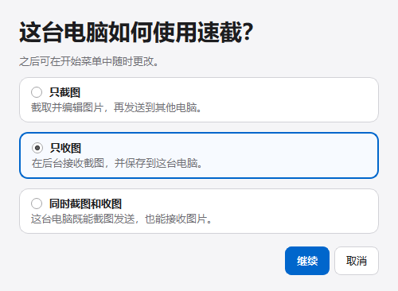
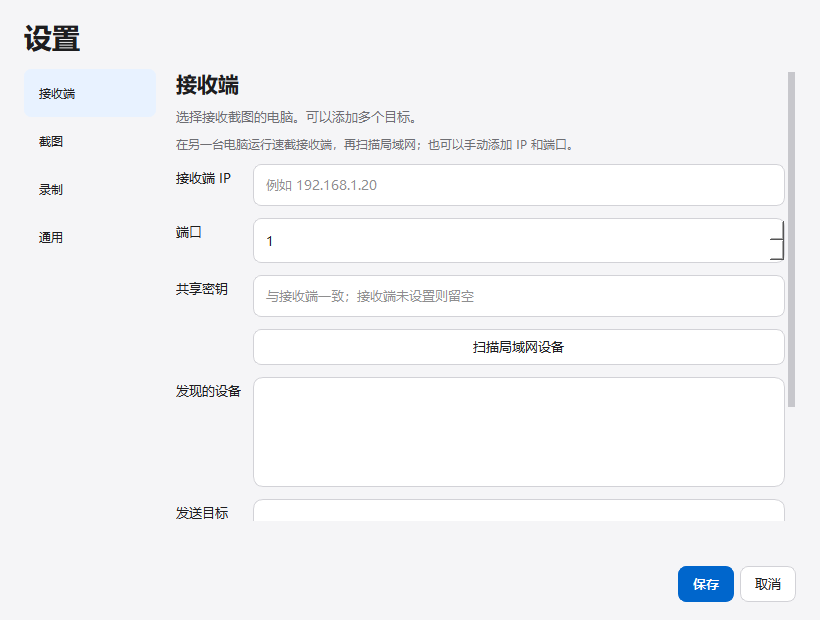
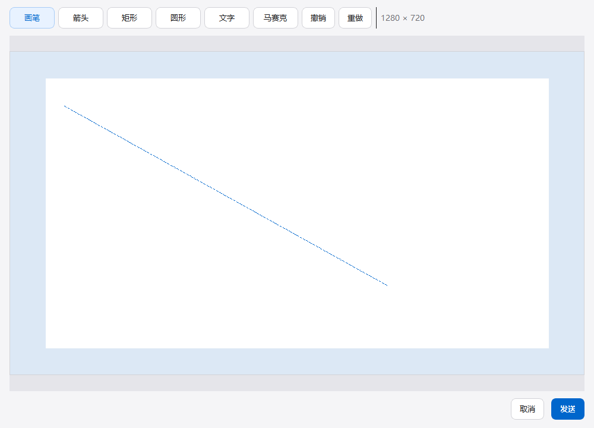
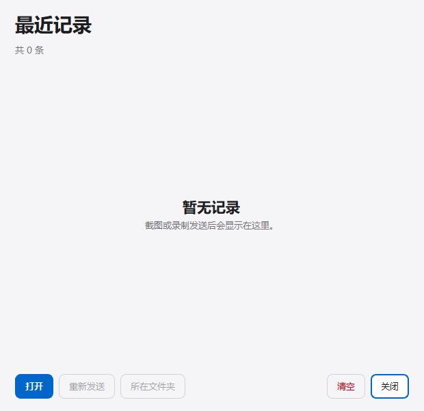

<div align="center">
  
  <h1>速截</h1>
  <p><strong>截图、标注、录屏，发到你的其他电脑。</strong></p>
  <p>
    
    
    
  </p>
</div>

## 界面预览

<table>
  <tr>
    <td align="center" width="50%">
      <br>
      <sub>每台电脑选择自己的工作模式</sub>
    </td>
    <td align="center" width="50%">
      <br>
      <sub>扫描局域网，管理多个接收目标</sub>
    </td>
  </tr>
  <tr>
    <td align="center" width="50%">
      <br>
      <sub>编辑完成后再发送</sub>
    </td>
    <td align="center" width="50%">
      <br>
      <sub>最近发送的截图和录屏集中查看</sub>
    </td>
  </tr>
</table>

## 能做什么

- **快速截图**：活动窗口、当前显示器、整个屏幕或手动框选。
- **截图后编辑**：画笔、箭头、矩形、圆形、文字、马赛克，支持撤销和重做。
- **局域网传图**：扫描设备或手动添加多个接收端，每个目标可单独设置密钥。
- **离线补发**：只重试未送达的目标，已成功接收的电脑不会重复收到。
- **录屏和贴图**：长按悬浮球打开四向菜单，录制屏幕、钉图对照或查看最近记录。
- **本机模式**：每台电脑可设为只截图、只收图或同时截图和收图。

## 快速开始

1. 在两台 Windows 电脑上安装同一个安装包，并连接到同一局域网。
2. 截图电脑选择「只截图」；收图电脑选择「只收图」。需要双向使用时选择「同时截图和收图」。
3. 截图电脑打开「设置 → 接收端」，扫描或手动添加收图电脑；然后单击悬浮球，编辑后点「发送」。

接收端默认把图片保存到「图片\速截」，并按日期分文件夹。模式选择后可从开始菜单「更改本机工作模式」修改；即使托盘图标不可见，也能从这里切换。

## 常用操作

| 操作 | 效果 |
| --- | --- |
| 单击悬浮球 | 按当前截图方式截取并打开编辑器 |
| 长按后向上滑 | 截图 |
| 长按后向左滑 | 开始录屏；再次单击悬浮球停止 |
| 长按后向右滑 | 把当前截图钉在屏幕上对照 |
| 长按后向下滑 | 打开最近记录 |
| `Ctrl` + `Alt` + `R` | 开始或停止录屏 |

## 网络与隐私

速截只在局域网内直接传输图片，不经过云服务或公网中继。HTTP 内容未加密；共享密钥用于访问校验，不用于加密图片。请只在可信局域网中使用，不要把接收端端口映射到公网。

## 从源码构建

需要 Windows、Python 3.10 或更新版本，以及 Inno Setup 6。

```powershell
python -m pip install PySide6 Pillow PyInstaller imageio-ffmpeg
powershell -NoProfile -ExecutionPolicy Bypass -File tools\package.ps1
```

安装包生成在 `dist\installer\速截-Setup-1.1.0.exe`。构建脚本会从 `imageio-ffmpeg` 准备录屏组件；大型 ffmpeg 文件不提交到仓库。

## 许可

本仓库目前没有指定开源许可证。公开仓库不代表授权复制、修改或分发。
